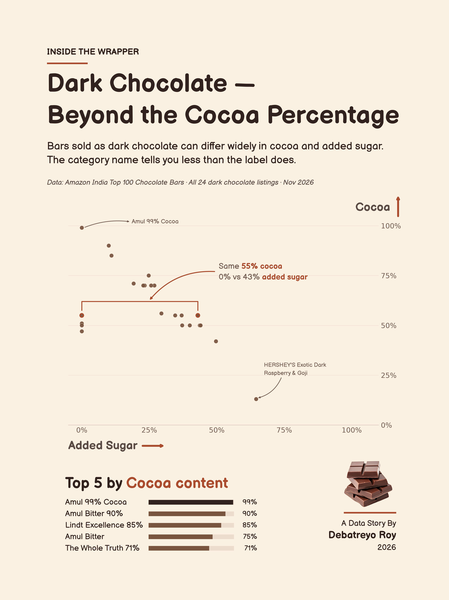

# Inside the Wrapper: Dark Chocolate — Beyond the Cocoa Percentage

Not all dark chocolates are created equal.

What began as a simple search for a dark chocolate bar to gift my sister turned into a small data exploration. While browsing Amazon India, I noticed considerable variation in **cocoa content** and **added sugar** among products marketed as dark chocolate.

This data story compares **24 dark chocolate listings** featured in **Amazon India's Top 100 Chocolate Bars (November 2026)**.

## The Data Story

- Bars sold as dark chocolate vary widely in both cocoa percentage and added sugar.
- Even at the **same 55% cocoa content**, added sugar ranges from **0% to 43%** in the products surveyed.
- The front of the wrapper doesn't always tell the whole story — sometimes the details are on the back.

## Visualization

[View full-resolution visualization](viz/dark_chocolate.jpeg)

## Tech Stack

## Data Source

Amazon India — Top 100 Chocolate Bars, November 2026.

*The analysis represents a snapshot of these 24 dark chocolate listings, not the broader dark chocolate market.*
